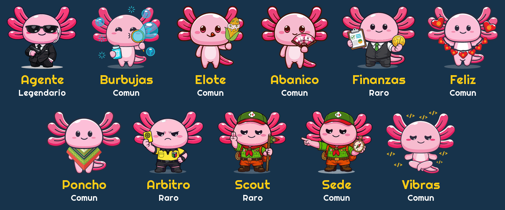
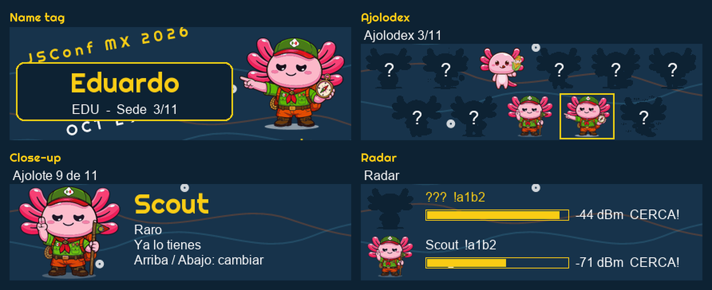

<div align="center">


Firmware for the Electronic Cats badge of [JSConf Mexico 2026](https://www.jsconf.mx/en/), Guadalajara, October 29 and 30.

Powered by [Meshtastic](https://meshtastic.org).

</div>


The badge is a LoRa mesh radio with a color screen and four buttons. This firmware is a fork of the [Meshtastic firmware](https://github.com/meshtastic/firmware) with one added target, `badge_jscon2026`. It does four things:

| Feature        | What the attendee gets                                                        |
| -------------- | ----------------------------------------------------------------------------- |
| Mesh messaging | Text messages between badges over LoRa, with no phone network or WiFi         |
| Name tag       | Their name in large letters, set from the Meshtastic phone app over Bluetooth |
| Axolotl game   | One axolotl per badge, and ten more to collect by getting near other people   |
| JSConf look    | Artwork, colors and typefaces from the JSConf Mexico 2026 asset kit           |

Everything else Meshtastic does still works: the badge shows up in the Meshtastic apps as a normal node.


Every badge is born with one axolotl. It is decided by the badge's MAC address, so it never changes and cannot be re-rolled. The other ten are unlocked by being near the people who carry them.



| Rarity     | Axolotls                                              | Share of badges |
| ---------- | ----------------------------------------------------- | --------------- |
| Comun      | Burbujas, Elote, Abanico, Feliz, Poncho, Sede, Vibras | 77%             |
| Raro       | Finanzas, Arbitro, Scout                              | 20%             |
| Legendario | Agente                                                | 3%              |

How an unlock happens:

1. Each badge broadcasts a short hello every 40 to 70 seconds that names its axolotl. Hellos are never relayed, so hearing one means the sender is within direct radio range.
2. When a badge hears two hellos from the same badge at -80 dBm or stronger, within 30 seconds, it unlocks that badge's axolotl.
3. The badge that was heard gets an answer back, so both people unlock from one encounter.
4. The collection is written to flash within half a second, so it survives unplugging.

The badge also counts how many different people it has met. Collecting all 11 earns the title "Maestro Ajolotero" on the name tag.


| Button | Pin  | On a page                               | Inside a menu or the close-up |
| ------ | ---- | --------------------------------------- | ----------------------------- |
| Up     | IO40 | Previous page                           | Move up                       |
| Down   | IO43 | Next page                               | Move down                     |
| Select | IO18 | Open the menu or close-up for that page | Confirm                       |
| Back   | IO01 | Turn the display off                    | Go back                       |

Each press counts once. There are no long presses.


| Page     | What it shows                                                                              |
| -------- | ------------------------------------------------------------------------------------------ |
| Home     | Node name, uptime and channel use                                                          |
| Messages | Text messages received over the mesh                                                       |
| Nodes    | Other nodes heard, with signal and last heard time                                         |
| LoRa     | Radio settings                                                                             |
| System   | Memory, storage and firmware version                                                       |
| Clock    | Time of day, once a phone or another node has provided it                                  |
| Ajolodex | The 11 axolotls: collected ones in color, the rest as silhouettes. Select opens a close-up |
| Radar    | Badges heard recently, strongest first, with a bar that fills as they get closer           |
| Name tag | The owner's name, their own axolotl and their progress                                     |

The images below are mockups drawn on a computer, not photos of the screen.




Download `badge_jscon2026-factory.bin` from the releases page. You need [esptool](https://github.com/espressif/esptool) 5 or newer: `pip install esptool`.

On Linux, `pip install` can refuse to run outside a virtual environment, and the `esptool` package that ships with some distributions is 4.x: it spells the commands `erase_flash` and `write_flash`, and the Ubuntu 4.7.0 package misses its flasher stubs and crashes with `FileNotFoundError ... stub_flasher_32s3.json`. Install version 5 in its own environment instead:

```bash
python3 -m venv ~/esptool-venv
~/esptool-venv/bin/pip install esptool
```

Then run `~/esptool-venv/bin/esptool` wherever the commands below say `esptool`.

```bash
esptool --chip esp32s3 --port <port> erase-flash
esptool --chip esp32s3 --port <port> write-flash 0x0 badge_jscon2026-factory.bin
```

On macOS the port looks like `/dev/cu.usbmodem11401`. On Linux it looks like `/dev/ttyACM0`.

- Erasing removes the badge's name, keys and axolotl collection. The badge's own axolotl comes back, because it is tied to the hardware.
- To update a badge and keep its name and collection, skip the erase and run only the `write-flash` command.
- If a badge does not start after flashing, hold BOOT, press RESET, release BOOT, and flash again.

A freshly flashed badge needs no setup: it starts on region US with the SHORT_FAST preset.


The build uses [PlatformIO](https://platformio.org).

```bash
pio run -e badge_jscon2026
pio run -e badge_jscon2026 -t upload --upload-port <port>
```

| Part        | Where                                             |
| ----------- | ------------------------------------------------- |
| Pins        | `variants/esp32s3/badge_jscon2026/variant.h`      |
| Build flags | `variants/esp32s3/badge_jscon2026/platformio.ini` |
| Buttons     | `src/input/BadgeJsconButtons.cpp`                 |
| Game rules  | `src/modules/badge/AxolotlGame.h`                 |
| Game radio  | `src/modules/badge/AxolotlModule.cpp`             |
| Game pages  | `src/graphics/draw/BadgeAxolotlRenderer.cpp`      |
| Color art   | `src/graphics/BadgeSprites.cpp`                   |
| Screenshot  | `src/graphics/BadgeScreenshot.cpp`                |
| Screen live | `src/graphics/BadgeStream.cpp`                    |

Hardware: ESP32-S3-WROOM-1-N8 with 8 MB of flash and no PSRAM, an LLCC68 LoRa radio at 915 MHz, a 428 x 142 NV3007 display, four pushbuttons, USB powered with no battery and no GPS.


| Item                                    | State                                                      |
| --------------------------------------- | ---------------------------------------------------------- |
| Boot, display, buttons, radio           | Working on hardware                                        |
| Badges hearing each other               | Measured at about 4 m: -39 to -53 dBm                      |
| Saving the collection across power loss | Working on hardware                                        |
| The -80 dBm threshold                   | At 4 m the signal is far stronger than -80      |
| `test/test_axolotl_game`                | Passes on a host compile, not yet in the repo test harness |

This badge uses SHORT_FAST, so it does not talk to Meshtastic nodes left on the stock LONG_FAST preset.


| Part                            | Author                                                                | License                                                               |
| ------------------------------- | --------------------------------------------------------------------- | --------------------------------------------------------------------- |
| Firmware                        | [Meshtastic](https://github.com/meshtastic/firmware) and contributors | [GPL-3.0](LICENSE)                                                    |
| Badge hardware and variant      | [Electronic Cats](https://electroniccats.com)                         | [GPL-3.0](LICENSE) for the code in this repository                    |
| Logos, backgrounds and axolotls | [JSConf Mexico 2026 asset kit](https://www.jsconf.mx/en/brandbook)    | [CC BY-NC-SA 4.0](https://creativecommons.org/licenses/by-nc-sa/4.0/) |
| Chango and Righteous typefaces  | Fontstage and Astigmatic                                              | [SIL Open Font License 1.1](https://openfontlicense.org)              |

Changes made to the artwork: rasterized, cropped, recolored where the screen needs it, converted to the display's pixel format, and the SVG copies in this repository were optimized. The kit's "costume" and "faq" files are the same drawings as "fan" and "bubbles", so the game has 11 axolotls, not 13. The artwork license does not allow commercial use.

Meshtastic is a registered trademark of Meshtastic LLC. This project is not endorsed by Meshtastic LLC.
